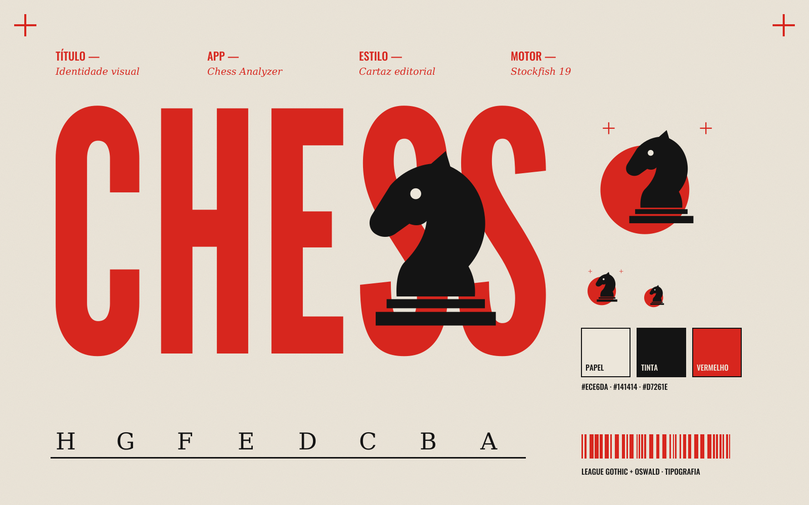

# Identidade visual — Chess Analyzer

Estilo **cartaz editorial**: papel creme, tinta preta e vermelho de impressão; letreiro gigante,
condensado e alto; detalhes pequenos de gráfica (marcas de registro "+", ficha técnica em vermelho,
código de barras, letras das colunas do tabuleiro). Tudo é minimalista: linhas finas, nada de
sombras ou bordas grossas. Os desenhos são originais do app.

## Marca
- **Símbolo:** cavalo em silhueta preta sobre um círculo vermelho, no papel creme (com "+" de
  registro nos cantos quando há espaço).
- **Letreiro:** "CHESS" em vermelho e "ANALYZER" em preto, fonte League Gothic (SIL OFL) convertida
  em contornos — o app não precisa carregar a fonte.
- **Cartaz do início:** "CHESS" gigante sangrando na borda e o cavalo na frente.

Arquivos: `assets/brand/logo.svg`, `logo-mono.svg`, `wordmark.svg`, `hero.svg`, `brand-sheet.*`;
no app, `src/brand/brandSvgs.ts` e `src/components/Logo.tsx` (`LogoMark`, `Wordmark`, `Lockup`, `Barcode`).
Ícones: `assets/icon.png`, `assets/android-icon-*.png`, `assets/splash-icon.png`, `assets/favicon.png`.

## Cores (`src/theme.ts`)
| Nome | Hex | Uso |
|---|---|---|
| Papel | `#ECE6DA` | Fundo de todas as telas |
| Tinta | `#141414` | Texto, ícones, botões secundários, destaque (no código: `colors.mint`) |
| Vermelho | `#D7261E` | Ação principal, títulos grandes, aba ativa, números |
| Papel escuro | `#E2DBCC` / `#D7CFBE` | Cartões e áreas de apoio |

Tabuleiro padrão de quem instala agora: tema **Pôster** (papel e cinza quente).

## Tema escuro

O escuro é o **negativo do cartaz**, não um app "dark mode" genérico: fundo quase preto puxado para o marrom
(`#151413`, nunca preto puro), tinta creme (`#ece6da`) e o mesmo vermelho, um pouco mais vivo (`#e2392e`).

| Papel | Claro | Escuro |
|---|---|---|
| `bg` (papel) | `#ece6da` | `#151413` |
| `surface` / `surfaceAlt` | `#e2dbcc` / `#d7cfbe` | `#1e1c1a` / `#292623` |
| `border` (linha fina) | `#c4baa7` | `#3b3732` |
| `ink` = `text` = `mint` (traço forte) | `#141414` | `#ece6da` |
| `paper` (contraste do traço) | `#ece6da` | `#151413` |
| `red` | `#d7261e` | `#e2392e` |
| `onRed` (texto sobre vermelho) | `#f6f1e7` | `#f6f1e7` |

Regras: texto sobre vermelho usa `onRed`; sobre `ink`/`mint` usa `paper`/`bg`. Peças, avatares das peças e as
caixas branca/preta do relatório usam as cores reais das peças nos dois temas. Os SVGs da marca são desenhados no
claro e convertidos com `themeSvg()`.

Como funciona: os estilos leem as cores por getters (`get color() { return colors.text; }`); trocar o tema chama
`applyPalette()` e remonta as telas. Nunca no meio de uma partida (a troca espera ela acabar); a análise aberta
é reaberta sozinha.

## Princípios (referências: The Verge, Claude, Nike, Linear — awesome-design-md)

- **Grito e sussurro.** Condensado enorme só em títulos de destaque; rótulos pequenos em CAIXA ALTA com
  espaçamento largo (1,5–2,6 px). Nada de condensado gigante em botão.
- **Profundidade plana.** Linhas finas (1–1,5 px) no lugar de sombras; a cor é que dá destaque.
- **Cantos.** 4 para cartões, campos e botões; 3 para pílulas; 6 só em balões de chat; círculos só quando o
  objeto é redondo (disco da marca, botões de ícone, xeque).
- **Pouca cor.** Papel, tinta e vermelho. O verde/azul/laranja ficam só para a classificação dos lances.

## Componentes (`src/components/poster.tsx`)
- `PosterRow` — item de menu: número vermelho, título condensado, seta, linha fina embaixo.
- `SectionLabel` — "01 JOGAR" com linha preta.
- `PosterHeading` — título grande vermelho, condensado, em caixa alta.
- `PosterButton` — retângulo chapado (tinta ou vermelho) ou só com contorno fino; cantos quase retos.
- `MetaRow` — ficha técnica "TÍTULO — valor" em vermelho com itálico.
- `Cross` — marca de registro "+".

## Tipografia
- Letreiro e cartazes: League Gothic (em contornos SVG).
- Títulos no app: condensada pesada do sistema, CAIXA ALTA.
- Valores da ficha técnica e textos de apoio: itálico.

## Tom de voz
Direto, em português, sem enfeite.
